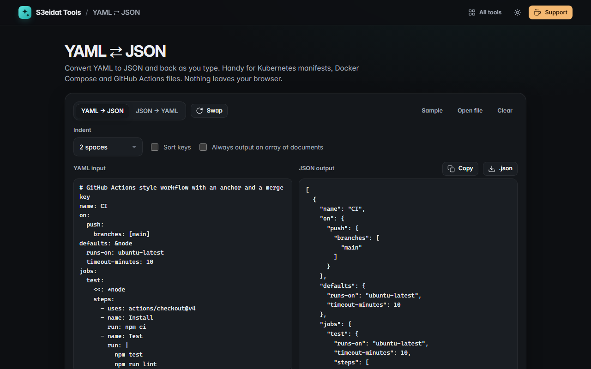

# YAML ⇄ JSON

> Convert YAML to JSON and JSON to YAML as you type. Free, private, and it runs entirely in your browser.

### ▶ [Open YAML ⇄ JSON](https://s3eidat.github.io/yaml-json/)



## Features

- **Live two-way conversion**: YAML → JSON and JSON → YAML, with a **swap** button to go back the other way
- Anchors, aliases and `<<` merge keys, block scalars, flow collections: everything YAML 1.2 offers
- **Multi-document YAML** (`---`) becomes a JSON array; optionally always output an array, or write a JSON array back as multiple documents
- Errors with the exact **line and column**, shown in context
- **Sort keys** (deep) and 2 or 4 space indentation
- Open or drop `.yaml`, `.yml` or `.json` files; copy or download the result
- Good for Kubernetes manifests, Docker Compose and GitHub Actions workflows

## Safety

Parsing uses [js-yaml](https://github.com/nodeca/js-yaml) 4.1 with its default **safe** schema: tags such as `!!js/function`,
`!!js/regexp` or `!!python/object` are rejected, so YAML can never run code. A guard stops "billion laughs" alias bombs and
self-referencing aliases before they can freeze the tab.

Notes: unquoted dates (`2026-10-26`) become ISO timestamps in JSON, and integers beyond 2^53 lose precision, as in any JavaScript tool.
Comments are not kept when converting, because JSON has no comments.

## Privacy

Your files never leave your device. There is no server, no account, no analytics.
The page ships with a strict Content-Security-Policy (`connect-src 'self'`), so the browser
itself blocks any attempt to send data anywhere.

## Run it yourself

It's plain HTML, CSS and JavaScript with no build step:

```bash
git clone https://github.com/s3eidat/yaml-json
cd yaml-json
python -m http.server 8000
```

Then open http://localhost:8000.

## Support

If this saved you time, **[buy me a coffee ☕](https://s3eidat.github.io/coffee/)**. It keeps every tool free.

---

Part of **[S3eidat Tools](https://s3eidat.github.io/)**: 100+ free, private tools that run in your browser. MIT licensed. js-yaml is MIT licensed.
